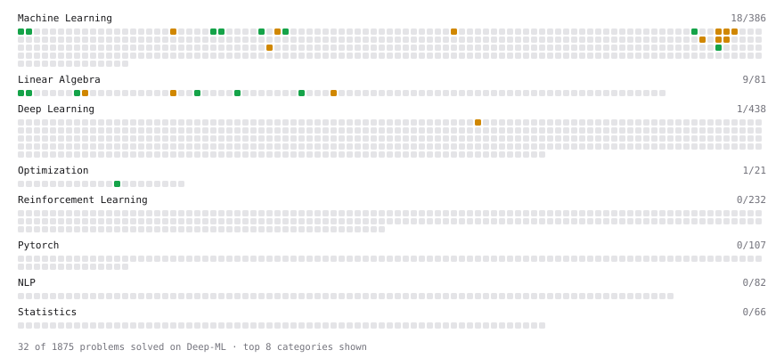

# Deep-ML

My machine learning practice from [Deep-ML](https://www.deep-ml.com). Every solution here was written by hand.

**67** solved · 40 problems · 0 labs · 27 math

[**Browse the interactive portfolio**](https://fexas.github.io/deep-ml/) to replay this filling in over time.

## Problems

| | Difficulty | Solved | |
| --- | --- | --- | --- |
| [Calculate 2x2 Matrix Inverse](https://www.deep-ml.com/problems/8) | easy | 2026-10-29 | [solution](problems/0008-calculate-2x2-matrix-inverse) |
| [Calculate Mean Absolute Error (MAE)](https://www.deep-ml.com/problems/93) | easy | 2026-10-30 | [solution](problems/0093-calculate-mean-absolute-error-mae) |
| [Calculate R-squared for Regression Analysis](https://www.deep-ml.com/problems/69) | easy | 2026-10-30 | [solution](problems/0069-calculate-r-squared-for-regression-analysis) |
| [Calculate Root Mean Square Error (RMSE)](https://www.deep-ml.com/problems/71) | easy | 2026-10-30 | [solution](problems/0071-calculate-root-mean-square-error-rmse) |
| [Demonstrate Law of Large Numbers with Sampling](https://www.deep-ml.com/problems/342) | easy | 2026-11-01 | [solution](problems/0342-demonstrate-law-of-large-numbers-with-sampling) |
| [Derivative of a Polynomial](https://www.deep-ml.com/problems/116) | easy | 2026-10-29 | [solution](problems/0116-derivative-of-a-polynomial) |
| [Detect Overfitting or Underfitting](https://www.deep-ml.com/problems/86) | easy | 2026-10-30 | [solution](problems/0086-detect-overfitting-or-underfitting) |
| [Dot Product Calculator](https://www.deep-ml.com/problems/83) | easy | 2026-10-28 | [solution](problems/0083-dot-product-calculator) |
| [Expected Value and Variance of an n-Sided Die](https://www.deep-ml.com/problems/179) | easy | 2026-11-01 | [solution](problems/0179-expected-value-and-variance-of-an-n-sided-die) |
| [Gradient Direction and Magnitude](https://www.deep-ml.com/problems/308) | easy | 2026-10-29 | [solution](problems/0308-gradient-direction-and-magnitude) |
| [Implement Orthogonal Projection of a Vector onto a Line](https://www.deep-ml.com/problems/66) | easy | 2026-10-29 | [solution](problems/0066-implement-orthogonal-projection-of-a-vector-onto-a-line) |
| [Implement Weight Decay as L2 Regularization](https://www.deep-ml.com/problems/198) | easy | 2026-11-01 | [solution](problems/0198-implement-weight-decay-as-l2-regularization) |
| [Learning Rate Range Finder for Linear Regression](https://www.deep-ml.com/problems/990) | easy | 2026-10-30 | [solution](problems/0990-learning-rate-range-finder-for-linear-regression) |
| [Linear Regression Using Gradient Descent](https://www.deep-ml.com/problems/15) | easy | 2026-10-20 | [solution](problems/0015-linear-regression-using-gradient-descent) |
| [Linear Regression Using Normal Equation](https://www.deep-ml.com/problems/14) | easy | 2026-10-20 | [solution](problems/0014-linear-regression-using-normal-equation) |
| [Matrix-Vector Dot Product](https://www.deep-ml.com/problems/1) | easy | 2026-10-28 | [solution](problems/0001-matrix-vector-dot-product) |
| [Sampling Distribution of the Mean](https://www.deep-ml.com/problems/181) | easy | 2026-11-01 | [solution](problems/0181-sampling-distribution-of-the-mean) |
| [Smooth L1 Loss with a Beta Parameter](https://www.deep-ml.com/problems/1372) | easy | 2026-10-30 | [solution](problems/1372-smooth-l1-loss-with-a-beta-parameter) |
| [Transpose of a Matrix](https://www.deep-ml.com/problems/2) | easy | 2026-10-29 | [solution](problems/0002-transpose-of-a-matrix) |
| [Vector Norms (L1/L2/L-inf) and the Frobenius Norm](https://www.deep-ml.com/problems/328) | easy | 2026-10-31 | [solution](problems/0328-vector-norms-l1-l2-l-inf-and-the-frobenius-norm) |
| [Bias-Variance Decomposition from Bootstrap](https://www.deep-ml.com/problems/804) | medium | 2026-11-01 | [solution](problems/0804-bias-variance-decomposition-from-bootstrap) |
| [Central Limit Theorem Simulation](https://www.deep-ml.com/problems/182) | medium | 2026-11-02 | [solution](problems/0182-central-limit-theorem-simulation) |
| [Chain Rule for Composite Functions](https://www.deep-ml.com/problems/214) | medium | 2026-10-29 | [solution](problems/0214-chain-rule-for-composite-functions) |
| [Check if Matrix is Positive Definite](https://www.deep-ml.com/problems/332) | medium | 2026-10-31 | [solution](problems/0332-check-if-matrix-is-positive-definite) |
| [Classify Critical Points Using Hessian Eigenvalues](https://www.deep-ml.com/problems/311) | medium | 2026-10-31 | [solution](problems/0311-classify-critical-points-using-hessian-eigenvalues) |
| [Compute the Hessian Matrix](https://www.deep-ml.com/problems/218) | medium | 2026-10-31 | [solution](problems/0218-compute-the-hessian-matrix) |
| [Cross-Validated Prediction with K-Fold Linear Regression](https://www.deep-ml.com/problems/839) | medium | 2026-10-30 | [solution](problems/0839-cross-validated-prediction-with-k-fold-linear-regression) |
| [Elastic Net Regression via Gradient Descent](https://www.deep-ml.com/problems/139) | medium | 2026-11-01 | [solution](problems/0139-elastic-net-regression-via-gradient-descent) |
| [Gaussian Elimination for Solving Linear Systems](https://www.deep-ml.com/problems/58) | medium | 2026-10-29 | [solution](problems/0058-gaussian-elimination-for-solving-linear-systems) |
| [Implement Gradient Descent Variants with MSE Loss](https://www.deep-ml.com/problems/47) | medium | 2026-10-30 | [solution](problems/0047-implement-gradient-descent-variants-with-mse-loss) |
| [Implement the Huber Loss Function](https://www.deep-ml.com/problems/192) | medium | 2026-10-30 | [solution](problems/0192-implement-the-huber-loss-function) |
| [Lagrange Multipliers for Constrained Quadratic Optimization](https://www.deep-ml.com/problems/314) | medium | 2026-10-31 | [solution](problems/0314-lagrange-multipliers-for-constrained-quadratic-optimization) |
| [Learning Curve Generator for Bias-Variance Diagnosis](https://www.deep-ml.com/problems/800) | medium | 2026-10-30 | [solution](problems/0800-learning-curve-generator-for-bias-variance-diagnosis) |
| [Linear Regression - Power Grid Optimization](https://www.deep-ml.com/problems/92) | medium | 2026-10-29 | [solution](problems/0092-linear-regression-power-grid-optimization) |
| [Matrix times Matrix ](https://www.deep-ml.com/problems/9) | medium | 2026-10-29 | [solution](problems/0009-matrix-times-matrix) |
| [Maximum A Posteriori (MAP) Estimation for Bernoulli Parameter](https://www.deep-ml.com/problems/338) | medium | 2026-11-01 | [solution](problems/0338-maximum-a-posteriori-map-estimation-for-bernoulli-parameter) |
| [Mini-Batch Gradient Descent Step for Linear Regression](https://www.deep-ml.com/problems/803) | medium | 2026-10-20 | [solution](problems/0803-mini-batch-gradient-descent-step-for-linear-regression) |
| [Numerical Gradient Checking](https://www.deep-ml.com/problems/313) | medium | 2026-10-30 | [solution](problems/0313-numerical-gradient-checking) |
| [Partial Derivatives of Multivariable Functions](https://www.deep-ml.com/problems/215) | medium | 2026-10-29 | [solution](problems/0215-partial-derivatives-of-multivariable-functions) |
| [Stochastic Gradient Descent Step for Linear Regression](https://www.deep-ml.com/problems/802) | medium | 2026-10-20 | [solution](problems/0802-stochastic-gradient-descent-step-for-linear-regression) |

## Math

| | Difficulty | Solved | |
| --- | --- | --- | --- |
| [Matrix Basics](https://www.deep-ml.com/math-problems/9) | easy | 2026-10-28 | [solution](math/0009-matrix-basics) |
| [Model Selection: CV, AIC, and BIC](https://www.deep-ml.com/math-problems/43) | easy | 2026-11-01 | [solution](math/0043-model-selection-cv-aic-and-bic) |
| [Probability Fundamentals](https://www.deep-ml.com/math-problems/19) | easy | 2026-11-01 | [solution](math/0019-probability-fundamentals) |
| [Standard Error and the Sampling Distribution of an Estimator](https://www.deep-ml.com/math-problems/73) | easy | 2026-11-01 | [solution](math/0073-standard-error-and-the-sampling-distribution-of-an-estimator) |
| [Vector Operations](https://www.deep-ml.com/math-problems/7) | easy | 2026-10-28 | [solution](math/0007-vector-operations) |
| [Why Minibatches: Gradient Variance vs Batch Size](https://www.deep-ml.com/math-problems/130) | easy | 2026-10-29 | [solution](math/0130-why-minibatches-gradient-variance-vs-batch-size) |
| [$C_p$, AIC, BIC, and Adjusted $R^2$](https://www.deep-ml.com/math-problems/93) | medium | 2026-11-01 | [solution](math/0093-c-p-aic-bic-and-adjusted-r-2) |
| [Best Subset and Stepwise Selection](https://www.deep-ml.com/math-problems/107) | medium | 2026-11-01 | [solution](math/0107-best-subset-and-stepwise-selection) |
| [Bias–Variance Decomposition](https://www.deep-ml.com/math-problems/39) | medium | 2026-11-01 | [solution](math/0039-bias-variance-decomposition) |
| [Common Distributions I: Bernoulli, Binomial, Uniform](https://www.deep-ml.com/math-problems/21) | medium | 2026-11-02 | [solution](math/0021-common-distributions-i-bernoulli-binomial-uniform) |
| [Inverse and Rank](https://www.deep-ml.com/math-problems/12) | medium | 2026-10-29 | [solution](math/0012-inverse-and-rank) |
| [Law of Large Numbers and Central Limit Theorem](https://www.deep-ml.com/math-problems/23) | medium | 2026-11-01 | [solution](math/0023-law-of-large-numbers-and-central-limit-theorem) |
| [LOOCV vs $k$-Fold: the Bias-Variance of $k$](https://www.deep-ml.com/math-problems/80) | medium | 2026-11-01 | [solution](math/0080-loocv-vs-k-fold-the-bias-variance-of-k) |
| [Matrix Multiplication](https://www.deep-ml.com/math-problems/10) | medium | 2026-10-28 | [solution](math/0010-matrix-multiplication) |
| [Multivariate Calculus](https://www.deep-ml.com/math-problems/2) | medium | 2026-10-29 | [solution](math/0002-multivariate-calculus) |
| [Optimization: Convexity and Critical Points](https://www.deep-ml.com/math-problems/6) | medium | 2026-10-31 | [solution](math/0006-optimization-convexity-and-critical-points) |
| [Orthogonality and Projections](https://www.deep-ml.com/math-problems/14) | medium | 2026-10-29 | [solution](math/0014-orthogonality-and-projections) |
| [Positive Definite Matrices and Quadratic Forms](https://www.deep-ml.com/math-problems/50) | medium | 2026-10-31 | [solution](math/0050-positive-definite-matrices-and-quadratic-forms) |
| [Regularization and Generalization](https://www.deep-ml.com/math-problems/31) | medium | 2026-10-31 | [solution](math/0031-regularization-and-generalization) |
| [Solving Linear Systems](https://www.deep-ml.com/math-problems/13) | medium | 2026-10-29 | [solution](math/0013-solving-linear-systems) |
| [Training Error, Test Error and the Bayes Rate](https://www.deep-ml.com/math-problems/104) | medium | 2026-10-30 | [solution](math/0104-training-error-test-error-and-the-bayes-rate) |
| [Vector Norms and Linear Independence](https://www.deep-ml.com/math-problems/8) | medium | 2026-10-31 | [solution](math/0008-vector-norms-and-linear-independence) |
| [What Goes Wrong in High Dimensions](https://www.deep-ml.com/math-problems/109) | medium | 2026-11-01 | [solution](math/0109-what-goes-wrong-in-high-dimensions) |
| [Interpolation and Double Descent](https://www.deep-ml.com/math-problems/118) | hard | 2026-11-01 | [solution](math/0118-interpolation-and-double-descent) |
| [Matrix Decompositions: LU and QR](https://www.deep-ml.com/math-problems/15) | hard | 2026-10-29 | [solution](math/0015-matrix-decompositions-lu-and-qr) |
| [Maximum Likelihood and MAP](https://www.deep-ml.com/math-problems/26) | hard | 2026-11-01 | [solution](math/0026-maximum-likelihood-and-map) |
| [Ridge vs Lasso: Constraint Geometry and Soft-Thresholding](https://www.deep-ml.com/math-problems/94) | hard | 2026-11-01 | [solution](math/0094-ridge-vs-lasso-constraint-geometry-and-soft-thresholding) |

---

_This file is regenerated by Deep-ML on every push._
